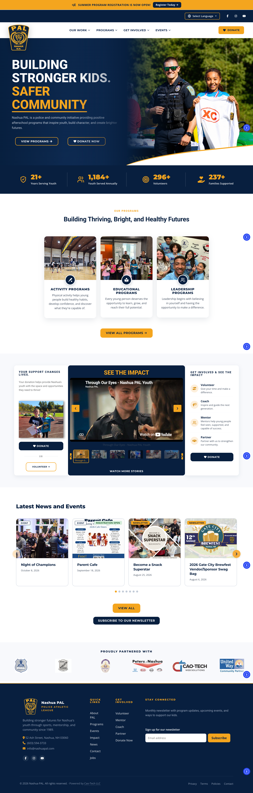
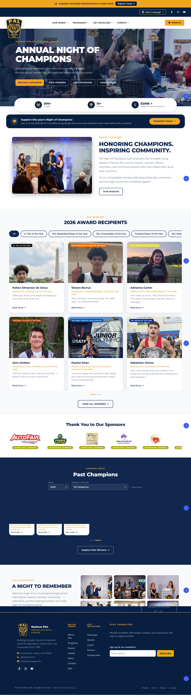

# Nashua PAL — Custom WordPress & Elementor Website

A custom website and content management system for **Nashua Police Athletic League**, built by **Hung Cao / Cao-Tech** to help staff maintain their own website.

The central goal was to make everyday updates straightforward: staff can publish programs and events, update sponsors and award recipients, change announcements, and manage site content through WordPress fields and reusable Elementor widgets. Shared layouts and brand styles keep those updates consistent across the site.

## My contribution

I built the custom **Nashua PAL Core** WordPress plugin, the **Hello Elementor child theme**, and the Elementor components and templates that connect the site's design to its editable content. The implementation covers PHP content models and rendering, WordPress admin tools, Elementor widget controls, responsive CSS, JavaScript interactions, and external service integrations.

The core plugin registers **107 custom Elementor widgets** and includes **41 Elementor JSON templates**. These provide a reusable editing system tailored to the organization's programs, fundraising events, people, and community content.

## Website previews

Screenshots of the implemented site, captured September 10, 2026. These show populated website pages; the repository contains the custom code and templates, rather than a complete copy of the production database.

### Homepage

Program discovery, impact statistics, video stories, news and events, community partners, and newsletter signup in a shared branded layout.



### Night of Champions

A dedicated fundraising event page with award recipients, sponsor recognition, past champions, and event photography.



## Built for staff to maintain

| Staff task | Custom functionality |
| --- | --- |
| Publish a program | Structured program fields for information, images, categories, and contacts, rendered through reusable program components. |
| Update events and news | Event and newsletter content types, event dates, archive views, and reusable listing widgets. |
| Update an annual fundraiser | Separate records for award recipients, sponsors, and auction packages; reusable Night of Champions sections and past-winner views. |
| Maintain leadership information | Board member, team member, and volunteer leader records with directory and profile components. |
| Change shared site information | Central settings for contact details, social links, donation links, impact statistics, promotional messages, and site alerts. |
| Assemble or update a page | A dedicated Nashua PAL widget category in Elementor, with content controls and style controls. |
| Reuse a page layout | An admin template importer for bundled page, header, footer, single-content, and archive templates. |

For example, staff can edit an award recipient's record and have that information appear in the associated winners grid. The page layout remains reusable, while the content is managed through purpose-built fields.

## Custom Elementor widgets

The widget library includes these component families:

- **Navigation and site tools:** logo, search, language switcher, social icons, promotional bar, site alert popup, mobile menu drawer, mobile menu button, and configurable mega menu.
- **Homepage and discovery:** statistics, program cards, upcoming events, news listings, partner carousels, community partners, and get-involved sections.
- **Reusable page sections:** hero banners, headings, card grids, icon lists, quotes, content boxes, photo galleries, video galleries, and calls to action.
- **Programs and events:** program featured images and information cards, single-program content, event sponsors, registration embeds, and awardee sections.
- **Night of Champions:** event hero, introduction, winners grid, sponsors, past champions, gallery, donation banner, and calls to action.
- **Fundraising and recognition:** auction packages, sponsorship packages and benefits, scholarship recipients, impact awardees, donor lists, membership sections, and Bright Future content.
- **People and documents:** board and team directories, volunteer leadership, impact reports, tax 990 documents, and board document components.
- **Media and footer:** YouTube carousel, contact information, newsletter signup, and footer components.

Widgets share a PHP base class that centralizes the Nashua PAL category, common styling controls, and shortcode rendering helpers. Many widgets wrap the plugin's `pal_*` shortcodes, allowing the same rendering logic to be reused in Elementor and shortcode-based content.

## Custom functions and integrations

- **Structured WordPress content:** custom post types, taxonomies, and admin meta boxes for programs, events, partners, jobs, newsletters, people, awards, sponsors, scholarships, and documents.
- **Central brand settings:** theme variables and shared styles for the navy, gold, and white visual identity, with configurable typography.
- **Responsive navigation:** WordPress menu integration, menu icons, configurable mega-menu panels, and a mobile drawer.
- **Google Calendar feeds:** public ICS feeds normalized into event data and cached with WordPress transients.
- **Constant Contact:** OAuth authorization, access-token refresh, and newsletter campaign synchronization tools.
- **Event registration embeds:** editable event embed content for external registration or fundraising services such as BetterUnite.
- **Interactive content:** carousels, galleries, category/year filters, and detail dialogs across relevant content modules.
- **Template management:** bundled Elementor template import, existing-template detection, and Theme Builder condition management.
- **Editor reference:** an in-admin shortcode reference with descriptions, supported attributes, and examples.
- **Theme integration:** page-specific stylesheets, archive and single-job templates, and a flexible page template in the child theme.

## Architecture

The core plugin owns content models, admin settings, integrations, shortcode rendering, and Elementor widgets. The child theme supplies the presentation foundation and WordPress template fallbacks. This keeps the site's content functionality in the plugin while allowing layouts to be composed in Elementor.

```text
nashua-pal-core/
  nashua-pal-core.php      Plugin entry point and version
  includes/
    cpt/                  Custom post types and taxonomies
    meta/                 Admin fields for structured content
    elementor/            Widget loader, shared base, and custom widgets
    class-*.php           Settings, rendering, integrations, and admin tools
  assets/                 CSS, JavaScript, and bundled imagery
  templates/              Elementor JSON and PHP templates
nashua-pal-child/
  functions.php           Theme setup and stylesheet routing
  style.css               Shared brand styles
  assets/css/             Page-specific styles
  *.php                   WordPress template files
docs/screenshots/        Website previews
```

Useful code entry points:

- [Plugin initialization](nashua-pal-core/includes/class-plugin.php)
- [Elementor widget registration](nashua-pal-core/includes/elementor/class-loader.php)
- [Shared Elementor widget base](nashua-pal-core/includes/elementor/class-widget-base.php)
- [Site settings](nashua-pal-core/includes/class-settings.php)
- [Night of Champions widgets](nashua-pal-core/includes/elementor/widgets-champions.php)
- [Template importer](nashua-pal-core/includes/class-template-importer.php)
- [Child theme setup](nashua-pal-child/functions.php)

## Technology

WordPress, PHP, JavaScript, jQuery, CSS, Elementor, Elementor Pro Theme Builder, and the Hello Elementor parent theme. External integrations include Constant Contact, public Google Calendar ICS feeds, YouTube, and embedded fundraising services.

## Installation

1. Prepare a WordPress installation. The core plugin declares WordPress **6.4+** and PHP **7.4+** as its minimum requirements.
2. Install the **Hello Elementor** parent theme and **Elementor**. Install and activate **Elementor Pro** for the Theme Builder layouts.
3. Upload [nashua-pal-core.zip](nashua-pal-core.zip) through **Plugins → Add New → Upload Plugin** and activate it.
4. Upload [nashua-pal-child.zip](nashua-pal-child.zip) through **Appearance → Themes → Add New → Upload Theme** and activate the child theme.
5. Configure the Nashua PAL settings, add content records, and assign WordPress navigation menus.
6. Use **Nashua PAL → Import Templates** to import the required layouts, then review page assignments and Theme Builder display conditions.
7. Configure any required external service credentials and feed URLs in the site administration.

The ZIP files contain the plugin and theme for deployment. WordPress, Elementor licenses, production content, and external service configuration are supplied separately. Installing this repository alone will not reproduce every populated page shown in the screenshots.

## Author

**Hung Cao — Cao-Tech**

Custom WordPress development, Elementor integration, and maintainable content systems.
